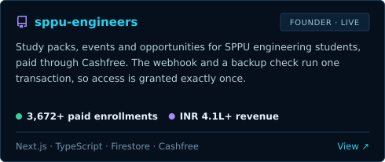
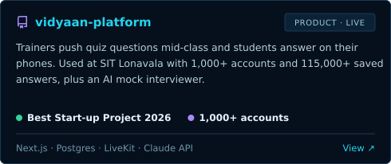
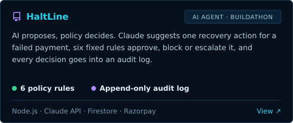
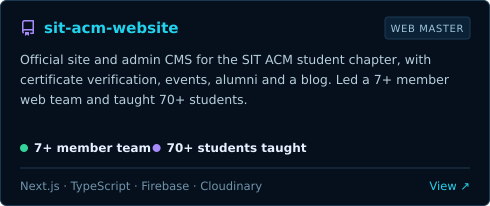
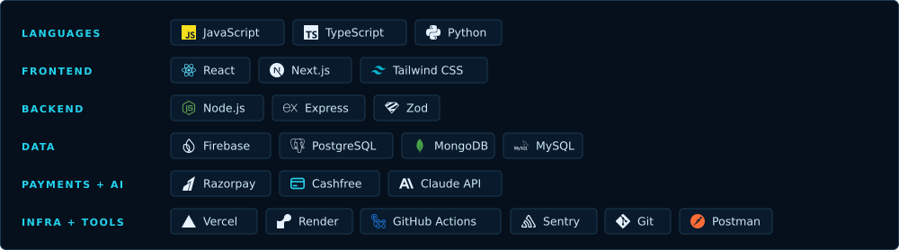

  
  
  

## About

I'm a final-year Computer Engineering student at SIT Lonavala, Pune. I build full-stack products and backend systems, mostly with Next.js, Node.js and Firebase. SPPU Engineers is my own platform: I started it in January 2025, I still run it alone, and 3,672+ students have paid for it.

| | |
|:--|:--|
| **Founder** | [SPPU Engineers](https://sppuengineers.in) &#124; 3,672+ paid enrollments, ₹4.1L+ revenue, 100+ colleges |
| **Building** | [Vidyaan](https://vidyaan.online) &#124; live quiz platform for colleges |
| **Web Master** | [SIT ACM Student Chapter](https://sitacm.vercel.app) &#124; official site and admin CMS |
| **Education** | B.E. Computer Engineering, SIT Lonavala (2027) |
| **How I work** | I use AI tools to write code faster, but I design the system and read every change. Payment code I check line by line. |
| **Find me** | [Portfolio](https://vishalghuge.com) &#124; [LinkedIn](https://www.linkedin.com/in/vishalghuge111) &#124; [GitHub](https://github.com/VishalGhuge111) &#124; [Email](mailto:vishalghuge.dev@gmail.com) &#124; [SPPU Engineers](https://sppuengineers.in) &#124; [Vidyaan](https://vidyaan.online) |

## Projects

<table>
<tr>
<td width="50%"></td>
<td width="50%"></td>
</tr>
<tr>
<td width="50%"></td>
<td width="50%"></td>
</tr>
</table>

## Tech stack

## Awards

| | Award | Result |
|:-:|:--|:--|
| 🏆 | **Smart India Hackathon 2025** | National Grand Finale winner, software category |
| 🥇 | **Best Start-up Project**, SIT Lonavala Expo | Vidyaan, top final-year project (Sep 2026) |
| 🎯 | **Infotsav Hackatron**, IIIT Gwalior | Top 10 of 800+ teams |
| 🎯 | **IEEE TechSangam 2K25**, MIT ADT University | Finalist, top 50 of 315+ teams |
| 🎯 | **MSBTE State-Level Project Competition** | Grand finalist |

  
  

  

  

  

